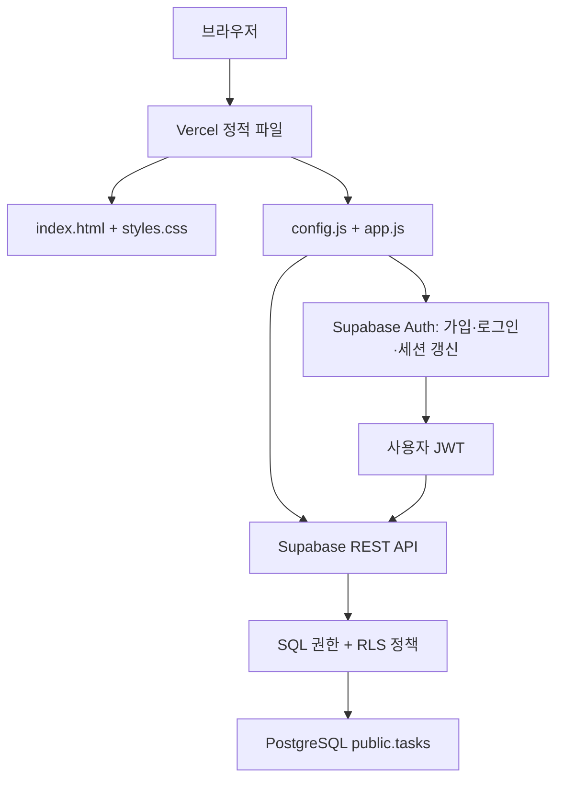

# 모아 칸반보드 — Supabase 아키텍처

## 1. 구성

```text
moa-supabase/
├── index.html           # 화면, 보드 선택, 인증 폼, 카드 편집 모달
├── styles.css           # 기존 스타일 및 계정 패널 반응형 스타일
├── config.js            # Supabase URL과 공개용 publishable 키
├── app.js               # Auth/REST 통신, 상태 관리, 렌더링 및 이벤트
├── supabase-schema.sql  # 테이블, 제약조건, 인덱스, RLS 및 SQL 권한
├── .vercelignore        # SQL 및 문서를 정적 배포에서 제외
├── README.md            # Supabase 적용 및 Vercel 배포 절차
└── 아키텍처.md          # 이 문서
```

별도 빌드, SDK, 프레임워크 및 자체 서버 없이 브라우저의 fetch API로 Supabase Auth와 PostgREST API를 호출합니다. Vercel은 정적 파일을 제공하고 Supabase는 인증과 카드 데이터 저장을 담당합니다.



## 2. 카드 모델

| 필드 | DB 자료형 | 역할 |
| --- | --- | --- |
| id | uuid | DB 기본값으로 생성하는 카드 식별자 |
| title | text | 공백 제거 기준 1~120자 필수 제목 |
| desc | text | 최대 2,000자 설명 |
| status | text | todo / doing / done |
| priority | text | high / normal / low |
| due | date, nullable | 마감일. 미입력 시 null |
| scope | text | public / private |
| owner_id | uuid, nullable | 개인 카드의 auth.users 사용자 ID |
| created_at | timestamptz | DB에서 기록하는 생성 시각 |

공용 카드는 owner_id가 null이어야 하고, 개인 카드는 소유자가 있어야 합니다. 계정이 삭제되면 해당 계정의 개인 카드도 외래 키의 ON DELETE CASCADE에 따라 삭제됩니다. 소유자가 없는 공용 카드는 남습니다.

## 3. 주요 모듈 및 상태

- `request()`: 공통 fetch 요청, JSON 직렬화 및 서버 오류 메시지 처리.
- `accessToken()`: 액세스 토큰 확인 및 만료 전 갱신. 중복 갱신은 하나의 Promise로 합칩니다.
- `setSession()`: 메모리/탭 세션 저장소의 로그인 상태와 화면을 갱신합니다.
- `boardFilter()`: 공용 또는 현재 사용자의 개인 보드 쿼리를 구성합니다.
- `loadTasks()`: 500개 단위 offset 페이지 조회. 서버의 더 작은 최대 행 제한에도 대응하도록 실제 반환된 개수만큼 offset을 증가시키고 빈 결과까지 조회합니다.
- `mutate()`: 생성·수정·삭제를 요청하고 반환된 카드가 정확히 하나일 때 화면에 적용합니다.
- `render()`, `openEditor()`: 기존 카드 UI 렌더링 및 입력 모달을 담당합니다.
- `tasks`: 현재 보드의 카드만 담는 메모리 배열입니다. 영구 저장소가 아닙니다.
- `ready`, `busy`, `loadVersion`: 로딩 완료, 중복 변경 차단, 오래된 조회 응답 무시를 관리합니다.

## 4. 카드 CRUD 흐름

### 조회

1. 보드 전환 시 기존 메모리 목록을 비워 개인 데이터의 잔상을 방지합니다.
2. 개인 보드라면 로그인을 요구합니다.
3. REST GET에 scope와 owner_id 필터를 붙이고 생성 시각·ID 순으로 조회합니다.
4. SQL 권한과 RLS가 서버에서 접근을 검사합니다.
5. 조회된 카드를 메모리에 반영하고 렌더링합니다.

클라이언트 필터는 UX 및 조회 범위 최적화 수단일 뿐, 보안 경계는 데이터베이스 RLS입니다. 전체·완료 개수는 현재 선택된 보드 기준입니다. 검색과 우선순위 필터는 조회한 보드 목록에 브라우저에서 적용합니다.

### 생성

REST POST로 제목, 설명, 상태, 우선순위, 마감일, 보드 종류, 소유자를 보냅니다. UUID와 생성 시각은 DB에서 생성합니다. 응답에 포함된 저장 결과만 화면에 추가합니다.

### 수정 및 드래그

REST PATCH에 ID와 현재 보드 필터를 적용합니다. 드래그 이동은 status만 변경합니다. 다른 수정은 편집 가능한 카드 필드만 전달합니다. 서버 성공 전에는 메모리 카드 상태를 변경하지 않습니다.

### 삭제

사용자 확인 후 ID와 현재 보드 필터로 DELETE 요청을 보내고, 삭제된 행이 응답되었을 때 화면에서 제거합니다.

모든 변경 요청은 `Prefer: return=representation`을 사용합니다. RLS에 의해 수정 대상이 보이지 않거나 다른 접속자가 삭제한 경우 0행 응답도 실패로 처리합니다. 네트워크 실패 시 모달과 기존 카드 상태를 유지합니다. 다만 서버에 저장된 직후 응답만 유실되면 결과를 즉시 확정할 수 없으므로 새로고침으로 확인해야 합니다.

## 5. 인증과 저장소

- 회원가입: `/auth/v1/signup`
- 로그인: `/auth/v1/token?grant_type=password`
- 토큰 갱신: `/auth/v1/token?grant_type=refresh_token`
- 복원된 사용자 검증: `/auth/v1/user`
- 로그아웃: `/auth/v1/logout`

모든 요청에 공개 키를 apikey 헤더로 전달하고, 로그인한 요청은 사용자 액세스 JWT를 Authorization Bearer로 전달합니다. publishable 키 자체는 JWT가 아니므로 Bearer 값으로 사용하지 않습니다.

카드 영구 저장은 Supabase만 사용합니다. sessionStorage는 로그인 토큰 보관에만 사용하며, 탭을 닫으면 로그인 정보가 사라질 수 있습니다. 일반적인 브라우저 토큰 보관 방식이므로 XSS 방지와 외부 스크립트 통제가 중요합니다. 사용자 입력은 기존 esc()로 이스케이프하여 카드 HTML에 삽입합니다.

## 6. 서버 권한 설계

| 작업 | 공용 카드 | 개인 카드 |
| --- | --- | --- |
| SELECT | anon/authenticated 허용 | auth.uid() = owner_id만 허용 |
| INSERT | owner_id가 null일 때 허용 | auth.uid() = owner_id만 허용 |
| UPDATE | 모두 허용 | 본인 카드만 허용 |
| DELETE | 모두 허용 | 본인 카드만 허용 |

RLS는 모든 CRUD에 적용합니다. UPDATE는 기존 행에 USING, 결과 행에 WITH CHECK를 검사합니다. 열 단위 권한으로 scope, owner_id, id, created_at의 클라이언트 변경을 차단합니다. 공개 키를 숨기는 것이 아니라 RLS와 SQL 권한을 통해 보호합니다. 관리자용 service_role 키는 포함하지 않습니다.

## 7. 운영 특성과 한계

- 공용 보드는 누구나 변경할 수 있으므로 비밀 데이터, 악의적 삭제 및 스팸에 주의해야 합니다.
- 실시간 구독과 폴링은 없습니다. 다른 접속자의 변경은 명시적 새로고침으로 반영됩니다.
- 동시 수정은 마지막으로 저장된 값이 남으며 버전 충돌 감지, 변경 이력 및 휴지통은 없습니다.
- offset 페이지 조회 중 다른 사용자가 대량으로 생성·삭제하면 목록이 순간적으로 달라질 수 있습니다. 재조회로 최신 상태를 확인합니다.
- 오프라인 저장 큐, 카드 로컬 백업 및 기존 localStorage 데이터 자동 이전은 제공하지 않습니다.
- 이메일 인증 완료 후 사이트에서 수동 로그인합니다. 비밀번호 찾기·재설정, 소셜 로그인 및 MFA 화면은 이번 범위에 포함하지 않습니다.
- 인증 실패나 네트워크 문제는 화면에 오류를 표시하며, 변경 성공을 가장하지 않습니다.

## 8. 확인 내역

JavaScript 구문 검사 및 모의 API 테스트에서 공용 카드 생성·수정·삭제, 실패 시 상태 보존, 개인 보드 로그인 제한, 로그인 후 개인 카드 생성, 보드 전환 시 목록 격리, 로그아웃 및 헤더 구성을 확인했습니다. HTML에서 참조하는 DOM ID와 외부 파일 연결도 확인했습니다.

실제 Supabase SQL 실행·RLS 정책 동작, 인증 메일 및 Vercel 배포는 이 환경에서 수행하지 않았습니다. README의 배포 후 체크리스트로 실제 적용을 확인해야 합니다.
